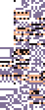
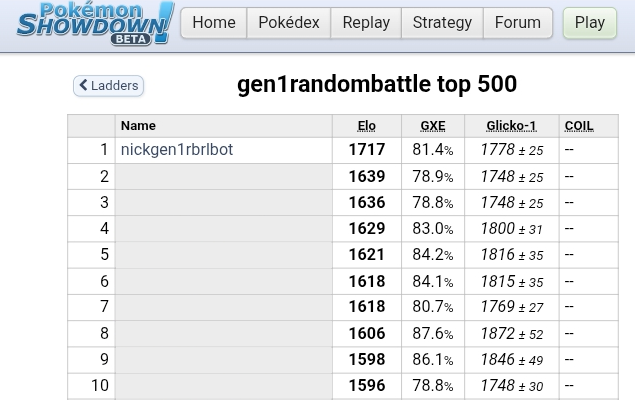
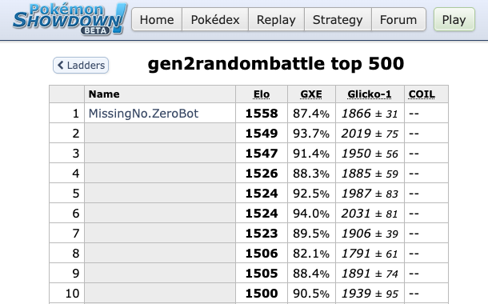
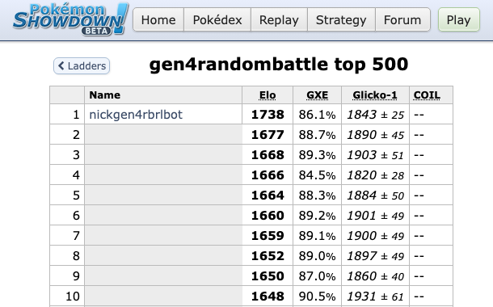
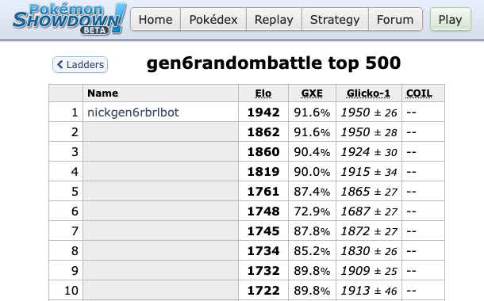
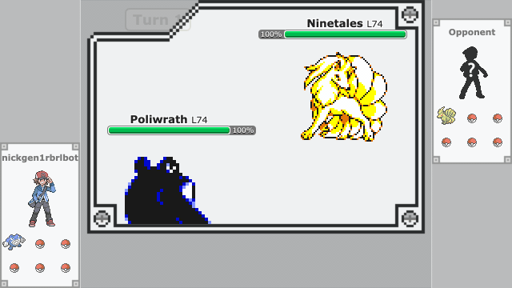
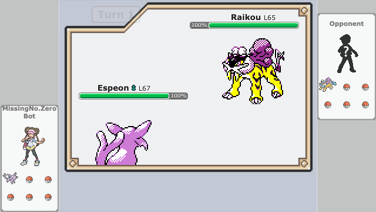
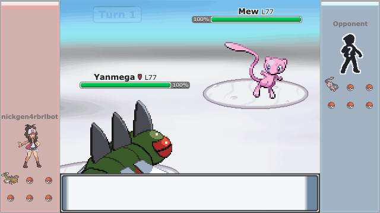
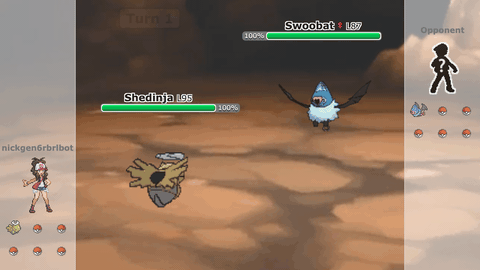
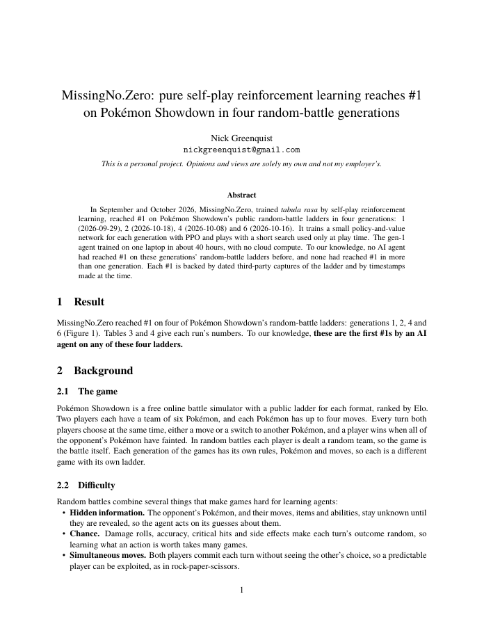

<p align="center">
  
</p>

<h1 align="center">MissingNo.Zero</h1>

<p align="center">
  <b>#1 on Pokémon Showdown's global random-battle ladders in four generations.</b>
</p>

<p align="center">
  <!-- TODO: the arXiv ID in every arxiv.org/abs/TODO and arxiv.org/pdf/TODO link and in the BibTeX, once the paper is announced -->
  <a href="https://arxiv.org/abs/TODO"></a>
  
</p>

<p align="center">
  In September and October 2026, MissingNo.Zero, trained <i>tabula rasa</i> by self-play reinforcement learning, reached
  #1 on Pokémon Showdown's public random-battle ladders in four generations.
</p>

<p align="center">
  To our knowledge, <b>no AI agent had reached #1 on these generations' random-battle ladders before, and none had
  reached #1 in more than one generation</b>.
</p>

<p align="center">
  📄 <b><a href="https://arxiv.org/abs/TODO">Read the paper</a></b> (arXiv, 2026) · <a href="https://arxiv.org/pdf/TODO">PDF</a>
</p>

<table>
  <tr>
    <th width="50%">Gen 1 · Red / Blue / Yellow</th>
    <th width="50%">Gen 2 · Gold / Silver / Crystal</th>
  </tr>
  <tr>
    <td width="50%"></td>
    <td width="50%"></td>
  </tr>
  <tr>
    <td align="center"><b>#1</b> on 2026-09-29 · peak Elo 1726 · <a href="https://web.archive.org/web/20260929211638/https://pokemonshowdown.com/ladder/gen1randombattle?snap=1790716595">archived at #1</a></td>
    <td align="center"><b>#1</b> on 2026-10-18 · peak Elo 1558 · <a href="https://web.archive.org/web/20261018142133/https://pokemonshowdown.com/ladder/gen2randombattle?snap=1792333234">archived at #1</a></td>
  </tr>
  <tr>
    <th width="50%">Gen 4 · Diamond / Pearl / Platinum</th>
    <th width="50%">Gen 6 · X / Y / Omega Ruby / Alpha Sapphire</th>
  </tr>
  <tr>
    <td width="50%"></td>
    <td width="50%"></td>
  </tr>
  <tr>
    <td align="center"><b>#1</b> on 2026-10-08 · peak Elo 1738 · <a href="https://web.archive.org/web/20261008184118/https://pokemonshowdown.com/ladder/gen4randombattle">archived at #1</a></td>
    <td align="center"><b>#1</b> on 2026-10-16 · peak Elo 1942 · <a href="https://web.archive.org/web/20261016121841/https://pokemonshowdown.com/ladder/gen6randombattle?snap=1792153118">archived at #1</a></td>
  </tr>
</table>

<p align="center"><sub>Each board's top 10 with our account at #1, at the highest Elo we have an image of (gen 1's shows
1717, below its 1726 peak). Other players' names are blanked. GXE is Showdown's estimate of the chance to beat a random
ladder player. Each #1 is backed by dated third-party captures of the ladder and by timestamps made at the time.</sub></p>

## Real games on the public ladder

<table>
  <tr>
    <td width="50%"></td>
    <td width="50%"></td>
  </tr>
  <tr>
    <td align="center">Gen 1 · beats a 1588-rated player</td>
    <td align="center">Gen 2 · beats a 1377-rated player</td>
  </tr>
  <tr>
    <td width="50%"></td>
    <td width="50%"></td>
  </tr>
  <tr>
    <td align="center">Gen 4 · beats a 1521-rated player</td>
    <td align="center">Gen 6 · beats a 1740-rated player</td>
  </tr>
</table>

<p align="center"><sub>Opponents anonymized. Every ladder account has "bot" in its name, the bot never poses as human,
and opponents who ask not to play a bot are opted out. Showdown opened its bot registry on 2026-10-13, and its staff
marked our accounts as bots, so the gen 2 and gen 6 runs were played as registered bots. No moderator contacted us
during any run. All four runs ended before 2026-10-20, when Showdown's code added an opt-in for ladder matchmaking
against bots (off by default).</sub></p>

## The paper

<p align="center">
  <a href="https://arxiv.org/abs/TODO"></a>
</p>

<p align="center">
  <b><a href="https://arxiv.org/abs/TODO">MissingNo.Zero: pure self-play reinforcement learning reaches #1 on Pokémon
  Showdown in four random-battle generations</a></b><br>
  Nick Greenquist · arXiv, 2026 · <a href="https://arxiv.org/abs/TODO">abstract</a> · <a href="https://arxiv.org/pdf/TODO">PDF</a>
</p>

<details>
<summary>Cite</summary>

```bibtex
@misc{greenquist2026missingnozero,
  title         = {{MissingNo.Zero}: pure self-play reinforcement learning reaches \#1 on {Pok\'{e}mon Showdown}
                   in four random-battle generations},
  author        = {Greenquist, Nick},
  year          = {2026},
  eprint        = {TODO},
  archivePrefix = {arXiv},
}
```

</details>

## How it learns

We take AlphaZero's premise ([Silver et al., 2018](https://doi.org/10.1126/science.aar6404)): one general algorithm that learns from self-play alone. Each
Pokémon generation is a new game for the same algorithm; what we change per generation is the rules, the input
encoding, and some training and search settings.

- **Self-play, no human data.** Each agent learns only from games against itself and its past versions: no human
  replays, no imitation of any player or bot, and no scripted opponents.
- **PPO.** A small policy-and-value network (about 3M parameters) is trained with proximal policy optimization
  ([Schulman et al., 2017](https://arxiv.org/abs/1707.06347)), with settings tuned per generation. Our starting recipe
  came from [Wang (2024)](https://dspace.mit.edu/handle/1721.1/153888), whose gen-4
  agent also paired PPO with play-time search.
- **Search only at play time.** Unlike AlphaZero, and as in Wang (2024), training uses no search. On the ladder, a
  short look-ahead search guided by the network's own policy and value picks each move, running on one laptop.

We describe the approach only at a high level and release no code or weights. Showdown's ladder is a community of
human players, and a detailed recipe would make it easy to run strong bots there that do not identify themselves as
bots.

### Strength against Foul Play

[Foul Play](https://pmariglia.github.io/posts/foul-play/) is an open-source search bot: it won the generation-9 OU track
of the NeurIPS 2025 [PokéAgent Challenge](https://arxiv.org/abs/2603.15563), and its author reported a peak rank of 3
on the gen-4 random-battle ladder. Each #1 model's win rate against it, without and with the model's play-time search,
played side by side:

| Gen | Without search | With search | Battles per column |
|---|---|---|---|
| 1 | 71.0% (69.3–72.6) | 71.2% (69.6–72.8) | 3,000 |
| 2 | 69.9% (64.0–75.2) | 80.9% (75.6–85.2) | 256 |
| 4 | 61.6% (59.4–63.7) | 67.5% (65.4–69.5) | 2,000 |
| 6 | 66.4% (60.4–71.9) | 68.4% (62.4–73.7) | 256 |

<sub>Win rate with its 95% Wilson interval. Foul Play's search is fixed per generation, so compare within a row only.
For gens 2, 4 and 6, these games used a smaller search than the ladder did, so their with-search numbers likely
understate ladder strength.</sub>

### Training cost

Every network trained from random weights. Later generations rented one GPU at a time to go faster.

| Gen | Training steps | Hardware | Time to train | Rented compute |
|---|---|---|---|---|
| 1 | 100M | laptop (Apple M4 Pro) | about 40 hours | none |
| 2 | 600M | rented GPU | about 3 days | about $160 |
| 4 | 700M | rented GPU | about 6 days | about $230 |
| 6 | 600M | rented GPU | about 4 days | about $170 |

## Why it's hard

Random battles combine several things that make games hard for learning agents:

- **Hidden information.** The opponent's Pokémon, and their moves, items and abilities, stay unknown until they are
  revealed, so the agent acts on its guesses about them.
- **Chance.** Damage rolls, accuracy, critical hits and side effects make each turn's outcome random, so learning what
  an action is worth takes many games.
- **Simultaneous moves.** Both players commit each turn without seeing the other's choice, so a predictable player can
  be exploited, as in rock-paper-scissors.
- **Size.** Random teams and many turns of branching make the game far too large to enumerate: Wang (2024) puts a
  conservative lower bound of about 10<sup>88</sup> on the game tree of generation 4's random battles.

## Prior work

- **Self-play.** [AlphaZero](https://doi.org/10.1126/science.aar6404) (Silver et al., 2018) mastered chess, shogi and
  Go with one self-play algorithm, searching during training as well as play.
- **Jaxcalibur.** [Jaxcalibur](https://jaxcalibur.github.io/) reached #1 on Showdown's generation-9 random-battle
  ladder in August 2026 with self-play PPO and play-time search (self-reported); its author released no code or
  weights.
  - **Our project started before Jaxcalibur's write-up.** Our gen-1 agents were on the ladder from August 2026, and
    the last one built before the write-up reached #5 on the gen-1 board.
  - The write-up showed that self-play PPO without search in training could reach #1 in generation 9. We then
    dropped search from training, as Wang (2024) had, and adopted several of its published ideas.
- **Other Pokémon agents.** Earlier bots reported peak ranks of 8 ([Wang, 2024](https://dspace.mit.edu/handle/1721.1/153888))
  and 3 ([pmariglia, 2025](https://pmariglia.github.io/posts/foul-play/)) on the gen-4 random-battle board.
  - The [PokéAgent Challenge](https://arxiv.org/abs/2603.15563), a NeurIPS 2025 competition (Karten et al., 2026),
    was played in generation 1 OU and generation 9 OU, where players build their own teams, on a separate server for
    AI agents, and reports no public-ladder rank.
- **Earlier #1s.** To our knowledge, no agent before ours reached #1 on the generation 1, 2, 4 or 6 random-battle
  ladders, or in more than one generation; every earlier AI #1 we found was in generation 9, including Jaxcalibur's
  in random battles.

---

## About

Nick Greenquist · [nickgreenquist.com](https://nickgreenquist.com)

Built on [Pokémon Showdown](https://github.com/smogon/pokemon-showdown), [poke-env](https://github.com/hsahovic/poke-env),
[pkmn/engine](https://github.com/pkmn/engine) and [poke-engine](https://github.com/pmariglia/poke-engine); the GIFs are
rendered with Showdown's replay viewer.

<sub>This is a personal project. Opinions, code, and views are solely my own and not my employer's.</sub>
