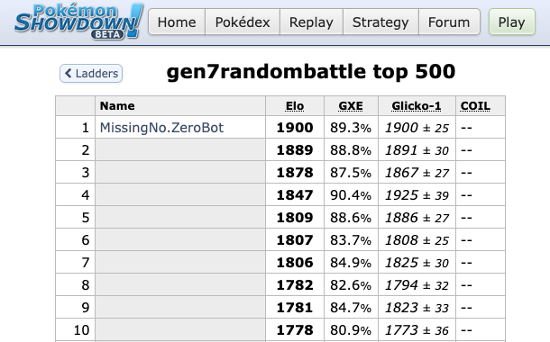
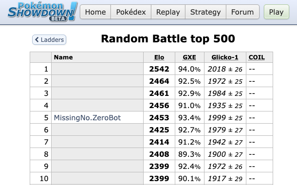
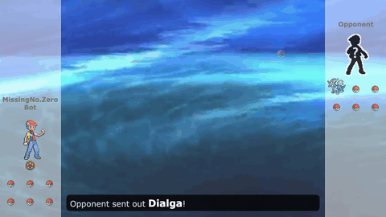
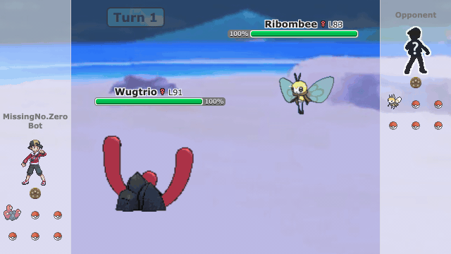

  

<h1 align="center">MissingNo.Zero</h1>

  <b>#1 on Pokémon Showdown's global random-battle ladders in five generations.</b>

  
  

  📄 <b><a href="missingno-zero.pdf">Read the paper</a></b> (PDF, 7 pages)

In September and October 2026, MissingNo.Zero, trained *tabula rasa* by self-play reinforcement learning, reached #1 on Pokémon Showdown's public random-battle ladders in five generations.

To our knowledge, **no AI agent had reached #1 on these generations' random-battle ladders before, and none had reached #1 in more than one generation**.

<table>
  <tr>
    <th width="50%">Gen 1 · Red / Blue / Yellow</th>
    <th width="50%">Gen 2 · Gold / Silver / Crystal</th>
  </tr>
  <tr>
    <td width="50%"></td>
    <td width="50%"></td>
  </tr>
  <tr>
    <td align="center"><b>#1</b> on 2026-09-29 · peak Elo 1726 · <a href="https://web.archive.org/web/20260929211638/https://pokemonshowdown.com/ladder/gen1randombattle?snap=1790716595">archived at #1</a></td>
    <td align="center"><b>#1</b> on 2026-10-18 · peak Elo 1558 · <a href="https://web.archive.org/web/20261018142133/https://pokemonshowdown.com/ladder/gen2randombattle?snap=1792333234">archived at #1</a></td>
  </tr>
  <tr>
    <th width="50%">Gen 4 · Diamond / Pearl / Platinum</th>
    <th width="50%">Gen 6 · X / Y / Omega Ruby / Alpha Sapphire</th>
  </tr>
  <tr>
    <td width="50%"></td>
    <td width="50%"></td>
  </tr>
  <tr>
    <td align="center"><b>#1</b> on 2026-10-08 · peak Elo 1738 · <a href="https://web.archive.org/web/20261008184118/https://pokemonshowdown.com/ladder/gen4randombattle">archived at #1</a></td>
    <td align="center"><b>#1</b> on 2026-10-16 · peak Elo 1942 · <a href="https://web.archive.org/web/20261016121841/https://pokemonshowdown.com/ladder/gen6randombattle?snap=1792153118">archived at #1</a></td>
  </tr>
  <tr>
    <th width="50%">Gen 7 · Sun / Moon / Ultra Sun / Ultra Moon</th>
    <th width="50%">Gen 9 · Scarlet / Violet</th>
  </tr>
  <tr>
    <td width="50%"></td>
    <td width="50%"></td>
  </tr>
  <tr>
    <td align="center"><b>#1</b> on 2026-10-24 · peak Elo 1900 · <a href="https://web.archive.org/web/20261024193431/https://pokemonshowdown.com/ladder/gen7randombattle?snap=1792870430">archived at #1</a></td>
    <td align="center"><b>Top 10</b> · best <b>#5</b> on 2026-10-25 · peak Elo 2453 · <a href="https://web.archive.org/web/20261025072637/https://pokemonshowdown.com/ladder/gen9randombattle?snap=1792913158">archived at #5</a></td>
  </tr>
</table>

Each board's top 10 with our account at #1 (gen 9's at #5, its best; it did not reach #1), at the
highest Elo we have an image of (gen 1's shows 1717, below its 1726 peak). Other players' names are blanked. GXE is Showdown's estimate of the chance to beat a random
ladder player. Each #1 is backed by dated third-party captures of the ladder and by timestamps made at the time.

## Real games on the public ladder

<table>
  <tr>
    <td width="50%"></td>
    <td width="50%"></td>
  </tr>
  <tr>
    <td align="center">Gen 1 · beats a 1588-rated player</td>
    <td align="center">Gen 2 · beats a 1377-rated player</td>
  </tr>
  <tr>
    <td width="50%"></td>
    <td width="50%"></td>
  </tr>
  <tr>
    <td align="center">Gen 4 · beats a 1521-rated player</td>
    <td align="center">Gen 6 · beats a 1740-rated player</td>
  </tr>
  <tr>
    <td width="50%"></td>
    <td width="50%"></td>
  </tr>
  <tr>
    <td align="center">Gen 7 · beats a 1692-rated player</td>
    <td align="center">Gen 9 · beats a 2385-rated player</td>
  </tr>
</table>

Wins over high-Elo players it faced. Opponents anonymized.

## How it learns

We take AlphaZero's premise ([Silver et al., 2018](https://doi.org/10.1126/science.aar6404)): one general algorithm that learns from self-play alone. Each Pokémon generation is a new game for the same algorithm; per generation we change only the rules, the input encoding, and some training and search settings.

- **Self-play.** Each agent learns only from games against itself and its past versions.
- **PPO.** A small policy-and-value network (about 3M parameters), trained with proximal policy optimization ([Schulman et al., 2017](https://arxiv.org/abs/1707.06347)). Our starting recipe came from [Wang (2024)](https://dspace.mit.edu/handle/1721.1/153888).
- **Search only at play time.** On the ladder, a short look-ahead search guided by the network's own policy and value picks each move.

### Strength against Foul Play

[Foul Play](https://github.com/pmariglia/foul-play) is an open-source search bot that won the generation-9 OU track of the NeurIPS 2025 [PokéAgent Challenge](https://arxiv.org/abs/2603.15563). Each model's win rate against it, without and with its play-time search:

| Gen | Without search | With search | Battles per column |
|---|---|---|---|
| 1 | 71.0% ± 1.6 | 71.2% ± 1.6 | 3,000 |
| 2 | 69.9% ± 5.6 | 80.9% ± 4.8 | 256 |
| 4 | 61.6% ± 2.2 | 67.5% ± 2.0 | 2,000 |
| 6 | 66.4% ± 5.8 | 68.4% ± 5.7 | 256 |
| 7 | 66.8% ± 5.8 | 71.9% ± 5.5 | 256 |
| 9 | 64.5% ± 5.8 | 66.8% ± 5.8 | 256 |

± is half the width of the 95% Wilson interval. Compare within a row only: Foul Play's search budget is fixed per generation. For gens 2, 4 and 6 these games used a smaller search than the ladder did.

### Training cost

Every network trained from random weights.

| Gen | Training steps | Hardware | Time to train | Rented compute |
|---|---|---|---|---|
| 1 | 100M | laptop (Apple M4 Pro) | about 40 hours | none |
| 2 | 600M | rented GPU | about 3 days | about $160 |
| 4 | 700M | rented GPU | about 6 days | about $230 |
| 6 | 600M | rented GPU | about 4 days | about $170 |
| 7 | 600M | rented GPU | about 4 days | about $220 |
| 9 | 800M | rented GPU | about 8 days | about $280 |

## How it differs from chess and Go

- **Hidden information.** Chess and Go show the whole board. Here the opponent's team, moves, items and abilities stay unknown until revealed.
- **Chance.** Chess and Go are deterministic. Here damage rolls, accuracy, critical hits and side effects make every turn random.
- **Simultaneous moves.** Chess and Go alternate turns. Here both players choose at once, so a predictable player gets exploited.
- **Random teams.** Chess and Go always start from the same position. Here every game starts from a new, randomly dealt matchup.

## Prior work

- **[AlphaZero](https://doi.org/10.1126/science.aar6404)** (Silver et al., 2018) mastered chess, shogi and Go with one self-play algorithm, searching during training as well as play.
- **[Wang (2024)](https://dspace.mit.edu/handle/1721.1/153888)** and **[Foul Play](https://pmariglia.github.io/posts/foul-play/)** (pmariglia, 2025) reported peak ranks of 8 and 3 on the gen 4 random-battle ladder.
- **The [PokéAgent Challenge](https://arxiv.org/abs/2603.15563)** (Karten et al., 2026), a NeurIPS 2025 competition, was played in gen 1 OU and gen 9 OU on a separate server for AI agents, with no public-ladder rank.
- **Earlier #1s.** To our knowledge, every earlier AI #1 was in gen 9, including Jaxcalibur's. None reached #1 in gens 1, 2, 4, 6 or 7, or in more than one generation.

## FAQ

**Did it use any human data?** 
No. No replays, no imitation of any player or bot, no scripted opponents.

**How long did it take?** 
The project started as an idea on July 25, 2026. Gen 1, the original goal, reached #1 66 days later; all five #1s came by October 24.

**What did it run on?** 
Gen 1 trained on one laptop. Each later generation rented one GPU for a few days to speed things up. On the ladder, the network and all of its search ran on the laptop's CPU.

**What did it cost?** 
About $2,006 of rented GPU time for the whole project, dead ends and tests included. The [Training cost](#training-cost) table covers only each final network's run.

**How was it benchmarked before laddering?** 
Against Foul Play, at a fixed search budget (see [Strength against Foul Play](#strength-against-foul-play)).

**Did it follow Showdown's bot rules?** 
Yes. Every account has "bot" in its name and never posed as human.
- Gens 1 and 4: #1 before Showdown had a bot policy (its bot registry opened 2026-10-13).
- Gens 2 and 6: registered bots, before the bot opt-in (2026-10-20); matched like any other account.
- Gens 7 and 9: after the opt-in; only opted-in players and other bots.

**How does this relate to Jaxcalibur?** 
[Jaxcalibur](https://jaxcalibur.github.io/) reached #1 in gen 9 in August 2026 with self-play PPO. Our gen 1 agents were already on the ladder then, and the last one built before its write-up reached #5. The write-up showed search in training wasn't needed, so we dropped it and adopted several of its ideas.

**Will you release the code or weights?** 
No. A detailed recipe would make it easy to run strong bots on Showdown that ignore its bot policy.

---

## About

Nick Greenquist · [nickgreenquist.com](https://nickgreenquist.com) · [GitHub](https://github.com/nickgreenquist) · [Smogon thread](https://www.smogon.com/forums/threads/missingno-zero-a-pure-self-play-reinforcement-learning-bot-that-reached-1-on-five-random-battle-ladders.3790707/)

Built on [Pokémon Showdown](https://github.com/smogon/pokemon-showdown), [poke-env](https://github.com/hsahovic/poke-env),
[pkmn/engine](https://github.com/pkmn/engine) and [poke-engine](https://github.com/pmariglia/poke-engine); the GIFs are
rendered with Showdown's replay viewer.

This is a personal project. Opinions, code, and views are solely my own and not my employer's.
